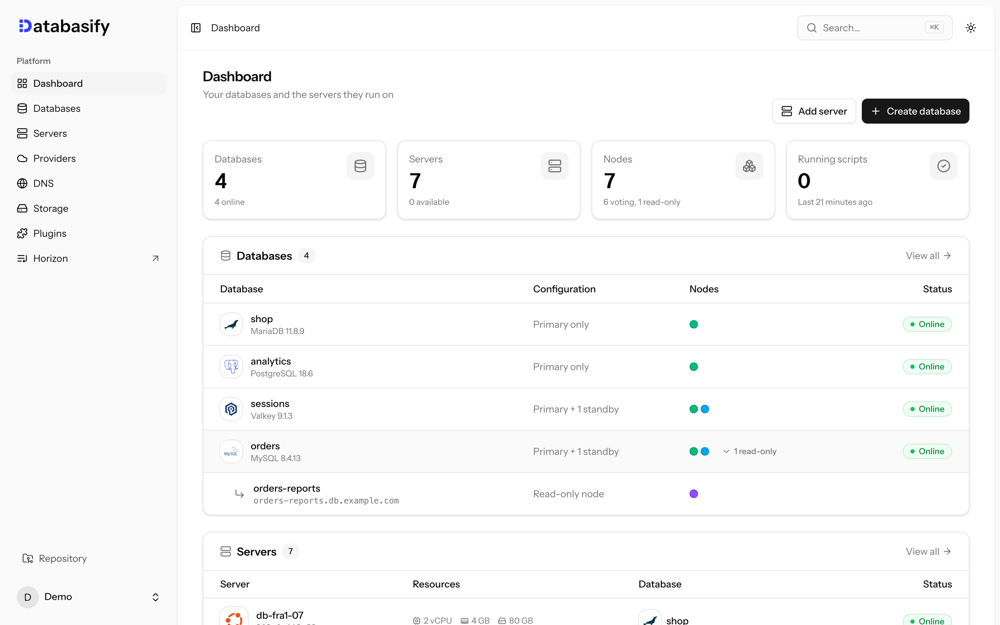

<h1>
  <picture>
    <source media="(prefers-color-scheme: dark)" srcset=".github/assets/logo-dark.svg">
    
  </picture>
</h1>

**Open-source alternative to DigitalOcean Managed Databases, Amazon RDS and Aiven.**

[](https://github.com/databasifylabs/databasify/actions/workflows/tests.yml)
[](https://laravel.com/docs/13.x)
[](https://www.php.net/releases/8.5/)
[](https://react.dev)
[](https://github.com/databasifylabs/databasify)

Databasify turns a few Linux servers you own into highly available MySQL, MariaDB, PostgreSQL, MongoDB, Valkey and Redis clusters, with one web UI to run them: the managed database experience, self-hosted, without the per-node markup.

<picture>
  <source media="(prefers-color-scheme: dark)" srcset=".github/assets/dashboard-dark.png">
  
</picture>

## Features

- MySQL 8.4 and 9.7, MariaDB 11.4 and 11.8, PostgreSQL 17 and 18, MongoDB 7.0, 8.0 and 9.0, Valkey 8 and 9, Redis 8
- Primary with standbys, automatic failover and read-only nodes
- Hostnames on your own domain and TLS everywhere
- Connection pools, users, metrics, logs and email alerts
- Migrations from an existing database
- Automatic updates in a weekly maintenance window
- Servers over SSH, or created on DigitalOcean, Hetzner, Vultr or Linode

## Installation

On a Linux server with at least 1 GB of memory:

```bash
curl -fsSL https://raw.githubusercontent.com/databasifylabs/databasify/0.x/scripts/install.sh | sudo bash
```

Update or uninstall the same way with `scripts/update.sh` and `scripts/uninstall.sh`.

## Development

```bash
composer install && npm install
cp .env.example .env && php artisan key:generate && php artisan migrate
composer run dev
```

Run the checks with `php artisan test`, `vendor/bin/phpstan analyse`, `vendor/bin/pint` and `npm run check`.

---

If Databasify saves you time, give it a ⭐ on [GitHub](https://github.com/databasifylabs/databasify). It helps others find it.
